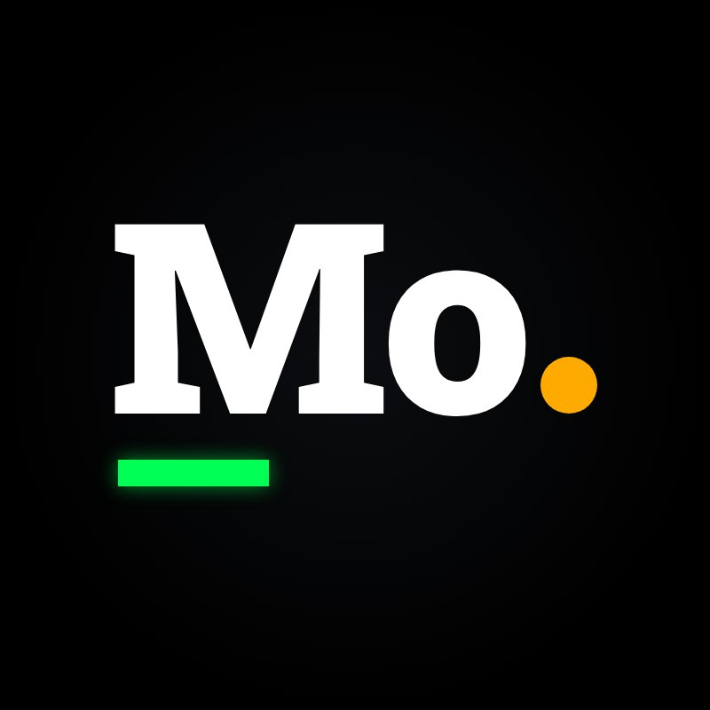
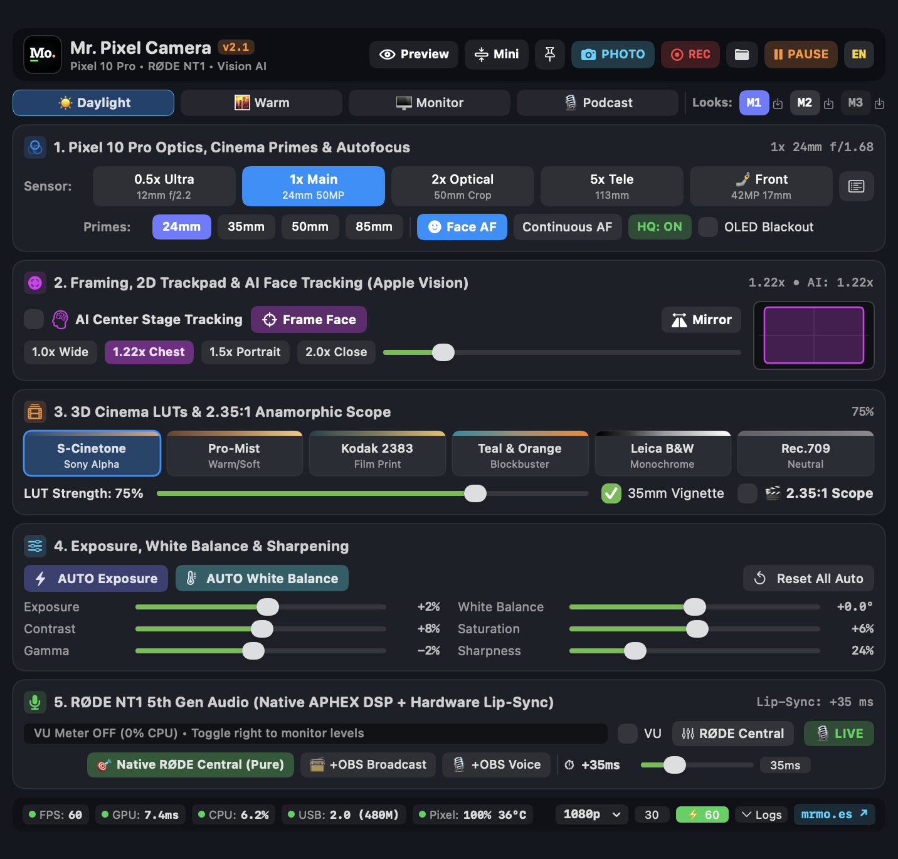

<p align="center">
  <a href="https://mrmo.es">
    
  </a>
</p>

<h1 align="center">Mr. Pixel Camera v2.1</h1>

<p align="center">
  <b>Zero-Latency (~32 ms), 1080p @ 60 FPS Cinema Control Center for Google Pixel USB Webcam + macOS + OBS Studio + RØDE DSP</b><br>
  <i>No phone app required • 3D Cinema LUTs • Apple Vision AI Auto-Framing • Hardware Lip-Sync • EN / RU</i><br><br>
  🌐 Built by <a href="https://mrmo.es"><b>mrmo.es</b></a>
</p>

<p align="center">
  
</p>

---

## ⚡ Why Mr. Pixel Camera Beats Camo / Iriun / DroidCam

Third-party webcam apps (`Camo`, `Iriun`, `DroidCam`) force you to install a heavy Android app that grabs frames via user-space `Camera2`, encodes them into inter-frame `H.264`, pushes packets over a proprietary `TCP / Android Open Accessory` socket, and decodes them again on your Mac — adding **90–140 ms of latency**, compression macroblocking, and heating the phone up to `43–45°C`.

**Mr. Pixel Camera** uses a fundamentally cleaner architecture built specifically for **Google Pixel (Android 14–17)** + **Apple Silicon Macs**:
1. **Kernel-Level UVC Video Pipe (`~32–35 ms` at `60 FPS`):** Video flows directly from Google Tensor's **Lyric Camera HAL** into Linux kernel V4L2 `/dev/video*` UVC and straight into macOS **`macos-avcapture-fast` (`IOSurface` zero-copy GPU textures)** with buffering disabled.
2. **Direct Hardware Control over USB (`ADB`):** Switches physical Pixel lenses (`0.5x Ultra-Wide 12mm`, `1x Main 50MP 24mm f/1.68`, `2x Optical In-Sensor 50mm`, `5x Telephoto 113mm`, `42MP Front Selfie`), triggers Face/Eye Tap-Autofocus, toggles `HQ` mode, and enables `Stay-On USB` + `OLED Blackout` without any third-party app running on the phone.
3. **16-Core Apple Neural Engine Auto-Framing (`Vision`):** Face tracking (`Center Stage`) runs on the Mac's **Apple Neural Engine (`VNDetectFaceRectanglesRequest`)** with `< 0.5% CPU` overhead and smooth cubic-bezier Dolly Zoom interpolation.

| Metric | **Mr. Pixel Camera v2.1 (Native UVC + OBS GPU)** | Camo Studio Pro / Iriun / DroidCam |
| :--- | :--- | :--- |
| **End-to-End Video Latency** | **`~32–35 ms` (at `1080p @ 60 FPS`)** | `90–140 ms` (H.264 GOP buffer + TCP socket) |
| **Phone App Required** | **None (`0 MB` — uses built-in Android `DeviceAsWebcam`)** | Requires background `.apk` service |
| **Phone Temperature (1h+ stream)** | **`35–36°C` (Battery stays at `100%` via 15W USB-PD)** | `42–45°C` |
| **Color Pipeline** | **33×33×33 `.cube` 3D LUTs on Apple Silicon GPU (`IOSurface`)** | Locked behind \$40–\$50/yr paywall |
| **Face Tracking (`Center Stage`)** | **macOS Apple Vision Neural Engine + Smooth Dolly Zoom** | Paid tier / CPU-heavy |
| **Audio Lip-Sync Calibration** | **Hardware millisecond offset (`+35 ms` @ 60fps / `+65 ms` @ 30fps)** | None |

---

## ✨ What's New in v2.1 Pro Cinema Dark Edition

- **🌐 Instant `EN / RU` Language Switcher:** Auto-detects macOS locale on first run (`EN` / `RU`) with a 1-click switcher in both the title bar and top macOS Menu Bar.
- **📺 Collapsible Live Studio Monitor (`Preview`) + `3×3` Rule-of-Thirds Grid:** View your final color-graded OBS output directly inside `PixelProCam Studio` (0% CPU when collapsed — safely hide OBS with `⌘H`).
- **🎛 Interactive 2D Framing Trackpad:** Drag the purple crop viewport anywhere to pan in real time; double-click to recenter smoothly.
- **🎨 Cinema Color Swatch Cards (`3D LUTs`):** Visual palette strips on all 6 one-click look cards (`Sony S-Cinetone`, `Black Pro-Mist Warm`, `Kodak 2383`, `Teal & Orange`, `Leica Monochrome B&W`, `Pure Rec.709`) + `35mm f/1.4` Optical Vignette & `2.35:1 Anamorphic Scope`.
- **💾 3 Custom User Memory Slots (`M1` / `M2` / `M3`):** Save and recall your complete look (`LUT + Exposure + WB + Zoom + Pan + 2.35:1`) in 1 click.
- **▫ Compact Mini Deck Mode (`Mini`):** Collapses the studio panel into a sleek single-row floating control strip above Zoom / Google Meet / Telegram.
- **🎥 Persistent macOS Menu Bar Extra (`NSStatusItem`):** Close the main window anytime and control everything from the top macOS Menu Bar.
- **🎙 RØDE NT1 5th Gen Native APHEX® Bypass + Hardware Lip-Sync (`+35 ms` / `+65 ms`):** Clean pass-through for `RØDE Central` onboard DSP without double-compression + millisecond lip-sync alignment.
- **📸 1-Click Studio Photo (`1920×1080 PNG`) & 🔴 Video Recording (`Apple VT HEVC`):** Saves directly into `./Captures`.

---

## 🚀 Quick Start (1-Click Install)

### Prerequisites
1. **macOS 13.0+** (Apple Silicon M1/M2/M3/M4 recommended) with **OBS Studio 30+** installed.
2. **Google Pixel (8 / 9 / 10 Pro)** connected via USB-C with:
   - USB preference set to **Webcam (`Веб-камера`)** in the Android USB notification.
   - **USB Debugging (`Отладка по USB`)** enabled in Developer Options (for physical lens switching & autofocus).

### Installation
```bash
git clone https://github.com/suprunoff/Mr-Pixel-Camera.git
cd Mr-Pixel-Camera
chmod +x install.sh
./install.sh
```

`install.sh` automatically copies all 3D LUTs and optical overlays into OBS Studio, compiles the native **`PixelProCam Studio.app`** bundle using `/usr/bin/swiftc`, enables OBS WebSocket on port `4455`, and launches the studio deck.

---

## 📁 Repository Structure

```text
Mr-Pixel-Camera/
├── macos/
│   └── PixelProCamStudio.swift      # Native macOS SwiftUI + AppKit + Vision AI Studio Deck (EN/RU)
├── assets/
│   ├── luts/                        # 33x33x33 3D Cinema LUTs (.cube)
│   ├── overlays/                    # 35mm Optical Vignette, 2.35:1 Letterbox & Privacy Standby (.png)
│   ├── icons/                       # Multi-resolution Retina AppIcon.icns
│   └── screenshots/                 # Retina UI preview
├── install.sh                       # 1-click macOS builder & OBS installer
└── LICENSE                          # MIT License
```

---

## 👤 Author & Links
- **Website:** **[https://mrmo.es](https://mrmo.es)**
- **GitHub:** **[@suprunoff](https://github.com/suprunoff)**
- **License:** MIT License — free for personal and commercial studio use.
